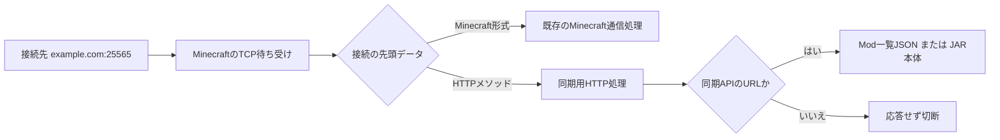

# Fabric Mod Sync 1.3.0 — 動作・通信仕様

## ポートの共有

専用サーバーがMinecraft用に開く **1つのTCP待ち受けソケット** を、通常接続と同期HTTPで共有します。標準設定なら、どちらも `example.com:25565` です。Minecraftが別のポートを使用している場合は、そのポートをそのまま指定します。

同期ModはMinecraftのNetty接続処理の入口に判別処理を追加します。別の公開ポート、内部のHTTP待ち受けポート、転送用プロキシプロセスは作りません。



`GET `、`HEAD `、`POST `などのHTTPメソッドの先頭文字列を判別します。通常のMinecraftハンドシェイクは「パケット長のVarInt、パケットID 0、プロトコル番号…」という形式なので区別できます。Minecraft側へ渡すデータは変更しません。

TCPでは1回の送信が複数回に分かれて届くことがあります。判別に必要な文字が途中までしか届いていれば待ち、HTTPかどうか決まった時点で、保持したデータをすべて選択先へ渡します。

HTTP接続だけをHTTP処理に切り替えます。ゲーム接続のハンドシェイク、サーバー一覧のping、ログイン、プレイ中の通信はMinecraft側で処理します。同期HTTPはログインより前の独立した接続なので、プレイヤーとしてログインしたり、接続人数の枠を使って転送したりしません。

## 設定と移行

サーバーの待ち受けアドレスとポートはMinecraftの `server.properties` が決めます。

```properties
server-ip=
server-port=25565
```


クライアントは「設定 → Mod同期設定」で、**ゲームと同じドメイン:ポート** を指定します。初期値は `localhost:25565`。以前保存した `:25566` などの接続先は、実際のMinecraftポートへ変更してください。既存の明示的な接続先は自動推測で書き換えません。


## 起動から再起動まで

1. クライアントでFabricがModを読み込み、タイトル画面へ到達します。
2. 同期が有効なら、その起動で一度、サーバーの一覧を取得します。無効なら問い合わせません。
3. サーバーは起動時にJARのサイズ・MD5・SHA-256・Fabricメタデータを計算してキャッシュします。要求時は設定の `files` を再読込して配布する集合を決めます。新しい名前の登録には `newFilesDefaultSelected` を使用します。
4. クライアントはMinecraft版、プロトコル版、Fabric Loader版を確認します。Loader版の不一致は自動変更せず、画面で案内します。
5. ローカルのJAR一覧・サイズ・MD5・SHA-256と比較し、保存した選択履歴を反映します。起動時に選択済みの変更がなければ確認画面を出さず戻ります。手動確認で差分がなければ、その旨を結果画面で表示します。
6. 不一致なら確認文とスクロール可能な導入・退避のチェックリストを表示します。サーバー専用は初期チェックを外し、手動で選択できます。
7. 同期しない場合も選択履歴を保存して戻ります。同期する場合は選択したファイルだけを取得し、未選択のファイルを保持した選択後の一覧を作ります。
8. 取得中はファイル名、転送済みサイズ、必要サイズ、ファイル数、全体の進捗率を表示します。まだMinecraftを終了せず、現在のModも変更しません。
9. 取得した各JARのサイズ・MD5・SHA-256、JAR形式、宣言された用途・IDを検証します。選択後にも同期Mod自身が残ることを確認します。
10. 一覧をもう一度取得し、最初と構成の世代が同じか確認します。転送中にサーバー構成やローカルModが変わっていれば中止します。
11. 同期計画を保存し、ヘルパーを別のJavaプロセスとして起動します。Javaの再起動引数は標準入力でヘルパーへ渡し、ディスクやログへ書き出しません。
12. ヘルパーの準備完了を確認してからMinecraftを終了します。
13. ヘルパーは元のMinecraftプロセスの終了を待ちます。120秒以内に終了しなければ入れ替えません。
14. 再度ローカル状態と取得ファイルを照合し、選択した退避対象と上書きするJARをバックアップへ移し、選択したJARを配置します。
15. 保持したModも含め、配置後のJAR一覧と全ハッシュが承認した選択後の構成 `target` に完全一致することを確認します。
16. 成功記録を保存し、同じJavaと起動引数でMinecraftを起動します。未選択の差分だけが残っている場合も確認画面を出しません。

「起動時に一度」は、同期の要否を判定する最初の一覧取得のことです。実際に同期する場合は、途中変更を検出するため、転送後にも一覧を再取得します。

Fabricが依存関係エラーでタイトル画面より前に停止する構成では、通常のMod内画面は表示することができません。任意の起動前エージェントは同じ通信仕様を使ってMod解決より前に確認します。この場合の画面はWindowsのダイアログで、Modが未読込なので、配置後にそのまま起動を続けます。

## HTTPの基本仕様

| 項目 | 内容 |
|---|---|
| 下位プロトコル | TCP。ゲームと同じアドレス・ポート |
| 同期プロトコル | HTTP/1.1。クライアントはHTTP/1.1を明示指定 |
| APIの世代 | URLは `/modsync/v1/`、一覧の `protocol` は整数1 |
| 認証 | 任意の共有トークン。`Authorization: Bearer <token>` |
| 一覧の文字コード | UTF-8 JSON |
| ファイル本文 | JARの生バイト列。Base64化しない |
| HTTP本文の長さ | `Content-Length` で明示 |
| 接続 | 1要求・1応答で `Connection: close` |
| キャッシュ | `Cache-Control: no-store` |
| 自動リダイレクト | 追従しない |
| アップロード | 実装なし。要求本文は不要 |
| 送信するクライアント一覧 | ローカルMod一覧・ローカルハッシュのアップロードは行わない |

クライアントが送る情報は、要求URL、要求するファイル名、任意のトークン、構成の世代を示すrevisionと通常のHTTP接続情報です。サーバーは配布する一覧を返し、クライアント側で比較します。したがってサーバーからは、クライアントがどのファイルを取得したかは接続内容から分かりますが、ローカルMod一式を送信する仕組みではありません。

### 1. 一覧の取得

```http
GET /modsync/v1/manifest HTTP/1.1
Host: example.com:25565
Authorization: Bearer <サーバーと共通のトークン>
```

認証を設定していなければ `Authorization` は送信不要です。

成功時の応答:

```http
HTTP/1.1 200 OK
Content-Type: application/json; charset=utf-8
Content-Length: <本文のバイト数>
Cache-Control: no-store
Connection: close
X-Content-Type-Options: nosniff
```

本文の構造（ハッシュの文字列は説明用）:

```json
{
  "protocol": 1,
  "enabled": true,
  "minecraft": "1.20.1",
  "loader": "0.19.5",
  "revision": "構成全体のSHA-256・小文字64桁",
  "files": [
    {
      "name": "example-mod-1.2.3.jar",
      "size": 123456,
      "md5": "ファイルのMD5・小文字32桁",
      "sha256": "ファイルのSHA-256・小文字64桁",
      "metadata": {
        "id": "example_mod",
        "name": "Example Mod",
        "version": "1.2.3",
        "environment": "BOTH",
        "provides": []
      },
      "defaultSelected": true
    }
  ]
}
```

| フィールド | 意味 |
|---|---|
| `protocol` | 同期プロトコルの互換性確認 |
| `enabled` | サーバー側で有効な配布構成があるか |
| `minecraft` | 対象Minecraft版。現在は1.20.1のみ |
| `loader` | サーバーのFabric Loader版。クライアントと同一であることを要求 |
| `revision` | 設定・ファイル集合・内容を含む構成全体の識別子 |
| `files[].name` | 配布先 `mods` 直下へ配置するファイル名 |
| `files[].size` | JARのバイト数 |
| `files[].md5` | JAR全体のMD5 |
| `files[].sha256` | JAR全体のSHA-256 |
| `files[].metadata` | Fabricの宣言から取得したID・表示名・バージョン・用途・提供ID。用途は `CLIENT`、`SERVER`、`BOTH`、`UNKNOWN`。 |
| `files[].defaultSelected` | クライアントの初期チェック。保存済みの選択が優先し、ユーザーは変更できる。 |

`metadata` と `defaultSelected` は1.3.0で加わった任意フィールドです。プロトコル番号と基本のrevision計算は1のままにし、1.0/1.1クライアントは追加フィールドを無視して従来の完全同期を行います。選択画面・履歴・用途タグには1.3.0クライアントが必要です。旧サーバーからメタデータが得られない場合は用途未判定とし、旧版を残す選択に対して未知の導入候補を保守的に連動させます。詳しいMod ID判定にはサーバーも1.3.0を使用してください。

`revision` は、次の文字列をUTF-8にし、SHA-256を小文字16進にした値です。改行はLF、区切りはタブです。ファイルはJavaの文字列比較で名前順に並べます。

```text
1\n
<enabledのtrue/false>\n
<minecraft>\n
<loader>\n
<name>\t<sizeの10進表記>\t<md5>\t<sha256>\n
...各ファイルについて繰り返し...
```

ここでの `\n` と `\t` は実際には改行とタブの1文字です。JSONの整形やフィールド順をそのままハッシュ化する方式ではありません。ファイル追加・削除・改名・内容変更に加え、enabledやLoader版の変更でもrevisionが変わります。

### 2. 差分ファイルの取得

```http
GET /modsync/v1/file/example-mod-1.2.3.jar HTTP/1.1
Host: example.com:25565
X-ModSync-Revision: <最初に取得したrevision>
Authorization: Bearer <任意のトークン>
```

ファイル名はURLのパス要素としてUTF-8でパーセントエンコードします。例として半角空白は `%20`、文字としての `+` は `%2B` です。

成功時:

```http
HTTP/1.1 200 OK
Content-Type: application/java-archive
Content-Length: <一覧に記載したsize>
ETag: "<ファイルのsha256>"
Cache-Control: no-store
Connection: close
X-Content-Type-Options: nosniff

<ここからJARの生バイト列>
```

サーバーは最新の配布選択とrevisionを照合し、その一覧に含まれるファイルだけを返します。既定のキャッシュでは送信前にサイズ・更新時刻・ファイル識別子を確認し、起動後に変わったファイルは409で拒否します。`verifyHashesBeforeTransfer=true` なら送信前の再ハッシュも行います。クライアントは `Content-Length`、受信量、MD5、SHA-256と宣言メタデータを照合します。`ETag` はSHA-256を示す補助情報で、最終照合は一覧の値に対して行います。

差分は **ファイル単位** です。同じ名前・サイズ・MD5・SHA-256なら転送しません。1バイトでも違えば、そのJAR全体を取得します。ブロック差分、HTTP Range、途中再開、圧縮し直しての転送は実装していません。送受信時のバッファサイズとTCPパケットの境界は、この仕様のファイル単位とは別です。

### 3. 転送後の再確認

再び `GET /modsync/v1/manifest` を送り、revisionが最初と同じか確認します。違えば、新旧ファイルを混ぜて配置せず、現在のMod構成を維持したままやり直しを案内します。

同じ場合もローカルModと取得ファイルが改変されていないことを確認してから入れ替えます。配置後は `target` のファイル集合まで一致させます。全選択ではサーバー構成と一致し、部分選択では承認した未選択Modを保持します。

## 主な応答コード

| コード | 意味・クライアントの扱い |
|---|---|
| `200` | 一覧またはJARを取得できた |
| `400` | 同期API内の不正な要求。一部は応答せず切断 |
| `401` | トークンがない、または一致しない。設定確認を案内 |
| `403` | 接続元IPが拒否リストに一致、または許可リストの範囲外 |
| `404` | 正しいファイル取得APIだが、配布構成にそのファイルがない |
| `405` | GET以外のHTTPメソッド |
| `409` | revision不一致、または配布ファイルが一覧作成後に変わった |
| `413` | 同期APIへの本文付き要求 |
| `500` | 設定読込・ファイル処理などの内部エラー |
| `503` | サーバー起動準備中、または同期処理の受付上限に達した |

HTTP構文やサイズ上限で拒否される要求は、NettyのHTTP処理でも拒否されます。正常な同期クライアントは本文付き要求を送りません。HTTPに見えない入力は通常のMinecraft側へ渡されるので、不正なMinecraftパケットとして切断される場合があります。

`/modsync/v1/manifest` と安全なファイル名を指定した `/modsync/v1/file/<name>.jar` 以外は、HTTPステータス・ヘッダー・本文を返さず接続を閉じます。`/`、`/favicon.ico`、未定義のAPIパスも対象です。未知のURLは本文を受け付けず拒否し、`Expect: 100-continue` に対しても応答しません。

## 完全同期と設定

- `enabled=false`: 配布を無効として通知します。
- `syncAllFiles=true`: 配布元直下の全JARが対象です。個別のfalseより優先します。
- `syncAllFiles=false` かつ `syncSelectedFiles=true`: `files` でtrueのJARだけを正解の構成とします。
- 両方false、または有効な選択が0ファイル: 同期無効として扱い、全ファイル退避を指示しません。
- サーバーのfalseは配布対象外を意味します。クライアント上の退避候補は、クライアントがチェックを外して保持できます。

比較対象はMod IDや申告バージョンだけでなく、実際のJAR名と内容です。同じMod ID・同じ申告バージョンでも内容が違えば更新し、別名で残る旧版も退避します。ただし、サーバー管理者が配布元に置いたMod群自体の依存関係や競合を自動修正する機能ではありません。

## 選択・履歴・競合制御

導入と退避の選択から、`before` に対して選択した退避を除き、選択した導入を追加した `target` を作ります。同名ファイルを上書きする場合は旧ファイルの退避が必須です。大文字小文字だけ異なるファイルも同じ物理名として連動し、同居させません。

通常モードでは宣言されたMod ID・提供IDが重なる候補を連動させ、同じIDの導入候補を複数選びません。上級者向けモードはこのMod ID制御を解除します。ファイル照合、上書き前バックアップ、パス検証、復旧は解除しません。Fabric Loaderの依存解決やすべての実行時互換性を代行する機能ではありません。

`config/fabric-mod-sync-selection.json` に、接続先、導入・退避、Mod ID、ファイル名ごとの選択を保存します。異なる同期先の履歴は共有しません。Mod IDのキーは、バージョン更新でファイル名が変わったときに使用します。アクセストークンは保存しません。

用途は `fabric.mod.json` の `environment` に従い、`client` はクライアント専用、`server` はサーバー専用、`*`・未指定は双方用とします。宣言のないModを名前だけでサーバー専用だと推測して除外することはありません。

## サーバー内のキャッシュ

- `hashCacheMode=startup`（既定）: 起動時に一度ハッシュとメタデータを計算。以後は同じ一覧・JSONを再利用し、選択が変わったときだけ一覧を作り直します。JAR追加・入れ替え・配布元変更には再起動が必要です。
- `hashCacheMode=on_change`: サイズ・更新時刻・ファイル識別子が変わったJARと、新規JARだけ再計算します。
- `hashCacheMode=disabled`: 要求時に毎回再計算します。
- `verifyHashesBeforeTransfer`: trueなら、上記とは別に送信前にも内容を再計算します。既定はfalseです。
- `newFilesDefaultSelected`: 新規に見つけた名前を `files` へ追加するときのtrue/false。既存項目を上書きしません。startupモードでも名前の登録は行いますが、未キャッシュのJARを配布するのは再起動後です。
- `excludeServerOnlyByDefault`: サーバー専用JARの初期チェックを外すヒントです。ユーザーは選択できます。配布を禁止する場合はサーバーの配布対象から外してください。

どのモードでも `files` の選択・有効無効・トークン・速度設定は稼働中に再読込します。キャッシュはサーバープロセス内のもので、HTTPの `Cache-Control: no-store` とは別の設定です。

## IP制限と要求ログ

同期APIでは、設定の読込、接続元IP、トークン、メソッド・要求本文の順に確認してから一覧やJARを準備します。IP拒否は403、認証失敗は401、GET以外は405、本文付き要求は413です。`Expect: 100-continue` に対して暫定応答を出さずに判定します。

`allowedIps`・`deniedIps` はIPv4/IPv6の単一IPとCIDRを受け付けます。拒否に一致すれば許可リストにあっても拒否し、許可リストが空なら拒否以外を許可します。IPv4を表すIPv6アドレスもIPv4として照合し、別表記による回避を防ぎます。対応するCIDRは `::ffff:192.0.2.0/120` のように96以上のプレフィックスを指定します。

ルール内のホスト名・ワイルドカードは受け付けず、名前解決は行いません。各リストの上限は1024項目です。TCP接続の相手IPを使い、転送ヘッダーは信用しません。この制限は同期HTTPだけに適用し、Minecraftの通信は元の処理へ渡します。

`logMode` はoff・normal・detailedで、`logRejectedRequests`・`logSuccessfulRequests`・`logTransfers` が出力対象を選びます。専用サーバーでは `FabricModSync` のSLF4Jロガーを使い、標準コンソール・ログへINFO/WARNを出します。任意の単体HTTPヘルパーではJDK標準ロガーを使います。新しい依存ライブラリの導入は不要です。

成功は応答の書込みが完了した時点で記録します。JARは書込みに成功した本文のバイト数を積算し、切断・送信失敗をabortedとして区別します。detailedでは予定バイト数・経過時間も表示します。クライアントから導入完了の通知を受けるプロトコルはなく、成功ログはクライアント側のハッシュ照合や導入完了を意味しません。

IPとログ設定は要求ごとに再読込し、受け付けた要求にはその時点の設定を使用します。不正な設定でIP制限を外すことはせず、既知APIは500、API外は引き続き無応答にします。設定を読めない場合の要求ログには直前に読めたログ設定を使います。起動案内・初期化エラーはこの要求ログ設定とは別です。

ログには接続元IP・メソッド・APIパス・状態・固定の理由を記録し、トークン・revisionヘッダー・クエリ文字列・設定内容は出しません。制御文字は除去し、API外のパスは `<outside-sync-api>` に置き換えます。status=0はHTTP応答を返さず閉じた要求を表します。HTTP構文の解析前やワーカーの受付上限で落ちた要求は、この要求ログの対象外です。

## 処理の分離・上限

初期ハッシュ計算はサーバーの起動処理で行います。起動後にon_change/disabledで必要となる計算とファイル転送は同期用ワーカーで処理し、ゲームやNettyのイベント処理で転送待ちを行いません。

- 同期ワーカー: 初期2、最大8、待機キュー32要求。
- 送信はワーカーごとに最大64 KiBのデータを区切って待機するため、JAR全体をメモリに展開しません。
- `maxBytesPerSecond` は1ダウンロード接続当たりの上限。0は無制限。
- 一覧: 最大4096ファイル、JSON本文は最大2 MiB。
- 1ファイル: 1バイト以上、最大2 GiB。合計最大32 GiB。
- ファイル名: 最大200 UTF-16コード単位。パス区切り、制御文字、Windows予約名などは拒否。
- HTTP要求行: 最大4096バイト、ヘッダー: 最大8192バイト、要求本文: 0バイト。
- 接続待ち: クライアント8秒。
- 一覧: 応答取得15秒、本文読込開始後も15秒の監視。
- JAR: 応答取得30秒、受信が30秒以上進まなければ中止。
- サーバー: HTTP要求の完了待ち30秒。要求受信後は読込タイマーを外し、長いダウンロードを30秒で切断しません。書込みが進まない場合の監視は30秒。

## 保存・復旧

取得先は `.modsync/transactions/<ID>/downloads/` です。一時ファイルは `.part` を付け、照合成功後に正式名へ変更します。

同期計画の `plan.json` にはサーバー一覧、変更前のローカルハッシュ、取得・退避対象、選択後の全ファイルを示す `target` を保存します。入れ替え直前に `journal.json` を保存し、バックアップを `backup/` に置きます。成功時は `COMMITTED`、復旧後は `ROLLED_BACK` になります。途中の `PREPARED` は次回ヘルパー実行時に復旧対象です。1.0/1.1が書いたtargetのない完全同期計画も復旧対象にできます。

全JARの配置後照合に成功してから再起動します。バックアップは自動削除しません。起動引数はメモリ上でのみ引き継ぎ、認証トークンを含む可能性があるためログへ出しません。

## 認証・暗号化・接続経路

同一ポートで直接提供する同期HTTPは平文です。Minecraftのオンライン認証やログイン後の暗号化は、別接続の同期HTTPには適用されません。

`accessToken` を設定した場合はBearer方式で検証します。

直接接続またはTCPをそのまま転送する経路で利用します。Velocity/BungeeCordなどのMinecraft専用プロキシや、一部のMinecraft専用トンネルはHTTPを通さないため、その入口で同じドメイン:ポートを共有できるとは限りません。通常のHTTPリバースプロキシだけではMinecraft通信も通せません。

クライアントは、設定されたホストへの接続を行います。MinecraftのSRVレコードを自動検索して同期先を解決する機能はありません。必要なら実際のTCP接続先とポートを明示するようにしてください。

## 参照

- [Fabric Yarn 1.20.1: ServerNetworkIo](https://maven.fabricmc.net/docs/yarn-1.20.1+build.10/net/minecraft/server/ServerNetworkIo.html)
- [Netty: ByteToMessageDecoder](https://netty.io/4.1/api/io/netty/handler/codec/ByteToMessageDecoder.html)
- [Fabric Loader: ModEnvironment](https://github.com/FabricMC/fabric-loader/blob/master/src/main/java/net/fabricmc/loader/api/metadata/ModEnvironment.java)
- [Fabric Loader: FabricLoaderImpl](https://github.com/FabricMC/fabric-loader/blob/master/src/main/java/net/fabricmc/loader/impl/FabricLoaderImpl.java)

上記は接続処理の拡張箇所と受信データの扱いの参照資料です。`/modsync/v1/` のURL、JSON、照合・再起動の手順はこのMod独自の仕様で通信します。
