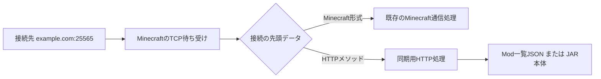

# Fabric Mod Sync 1.1.0 — 動作・通信仕様

## ポートの共有

専用サーバーがMinecraft用に開く **1つのTCP待ち受けソケット** を、通常接続と同期HTTPで共有します。標準設定なら、どちらも `example.com:25565` です。Minecraftが別のポートを使用している場合は、そのポートをそのまま指定します。

同期ModはMinecraftのNetty接続処理の入口に判別処理を追加します。別の公開ポート、内部のHTTP待ち受けポート、転送用プロキシプロセスは作りません。



`GET `、`HEAD `、`POST `などのHTTPメソッドの先頭文字列を判別します。通常のMinecraftハンドシェイクは「パケット長のVarInt、パケットID 0、プロトコル番号…」という形式なので区別できます。Minecraft側へ渡すデータは消費・変更しません。

TCPでは1回の送信が複数回に分かれて届くことがあります。判別に必要な文字が途中までしか届いていれば待ち、HTTPかどうか決まった時点で、保持したデータをすべて選択先へ渡します。「最初の1パケットが必ず全部届く」という前提は置いていません。

HTTP接続だけをHTTP処理に切り替えます。ゲーム接続のハンドシェイク、サーバー一覧のping、ログイン、プレイ中の通信はMinecraft側で処理します。同期HTTPはログインより前の独立した接続であり、プレイヤーとしてログインしたり、接続人数の枠を使って転送したりしません。

## 設定と移行

サーバーの待ち受けアドレスとポートはMinecraftの `server.properties` が決めます。

```properties
server-ip=
server-port=25565
```

`fabric-mod-sync-server.json` に同期専用のポート設定は不要です。1.0.0の `port` と `bindAddress` が残っていても1.1.0では使用しません。ファイル同期の設定は引き続き同じJSONで行います。

クライアントは「設定 → Mod同期設定」で、**ゲームと同じドメイン:ポート** を指定します。1.1.0の初期値は `localhost:25565`。以前保存した `:25566` などの接続先は、実際のMinecraftポートへ変更してください。既存の明示的な接続先は自動推測で書き換えません。

1.0.0から1.1.0への導入時は、古い同期ModのJARを外し、新しいJARを入れます。同じMod IDを持つ旧版と新版を同時に置かないでください。配布先の構成にも新しい同期Modを含めます。

1.0.0クライアントも、接続先を新しい共通ポートへ変更すれば、同じプロトコル1で1.1.0サーバーへ問い合わせられます。サーバー配布構成に1.1.0を含めることで、通常の差分同期による自己更新も可能です。

## 起動から再起動まで

1. クライアントでFabricがModを読み込み、タイトル画面へ到達します。
2. 同期が有効なら、その起動で一度、サーバーの一覧を取得します。無効なら問い合わせません。
3. サーバーは配布元フォルダのJARを列挙し、新しいファイル名を設定の `files` にtrueで追加します。現在の設定に従って配布するファイル集合を決め、各ファイルのサイズ・MD5・SHA-256を計算します。
4. クライアントはMinecraft版、プロトコル版、Fabric Loader版を確認します。Loader版の不一致は自動変更せず、画面で案内します。
5. ローカルのJAR一覧・サイズ・MD5・SHA-256と比較します。すべて同じならタイトル画面へ戻ります。
6. 不一致なら「サーバー側のModとこのクライアントのModに不整合があります。同期しますか？」を表示します。
7. 「しないでそのまま起動する」なら、その起動では変更せず戻ります。「同期して再起動する」なら、異なるファイルだけを取得します。
8. 取得中はファイル名、転送済みサイズ、必要サイズ、ファイル数、全体の進捗率を表示します。まだMinecraftを終了せず、現在のModも変更しません。
9. 取得した各JARのサイズ・MD5・SHA-256とJAR形式を検証します。同期Mod自身が配布構成に含まれることも確認します。
10. 一覧をもう一度取得し、最初と構成の世代が同じか確認します。転送中にサーバー構成やローカルModが変わっていれば中止します。
11. 同期計画を保存し、ヘルパーを別のJavaプロセスとして起動します。Javaの再起動引数は標準入力でヘルパーへ渡し、ディスクやログへ書き出しません。
12. ヘルパーの準備完了を確認してからMinecraftを終了します。
13. ヘルパーは元のMinecraftプロセスの終了を待ちます。120秒以内に終了しなければ入れ替えません。
14. 再度ローカル状態と取得ファイルを照合し、旧版・置き換え対象・余分なJARをバックアップへ移します。取得したJARを配置します。
15. 配置後のJAR一覧と全ハッシュが、承認したサーバー構成に完全一致することを確認します。
16. 成功記録を保存し、同じJavaと起動引数でMinecraftを起動します。次の起動では同期済みなので不整合画面は出ません。

「起動時に一度」は、同期の要否を判定する最初の一覧取得のことです。実際に同期する場合は、途中変更を検出するため、転送後にも一覧を再取得します。

Fabricが依存関係エラーでタイトル画面より前に停止する構成では、通常のMod内画面は表示できません。任意の起動前エージェントは同じ通信仕様を使ってMod解決より前に確認します。この場合の画面はWindowsのダイアログで、Modが未読込なので、配置後にそのまま起動を続けます。

## HTTPの基本仕様

| 項目 | 内容 |
|---|---|
| 下位プロトコル | TCP。ゲームと同じアドレス・ポート |
| 同期プロトコル | HTTP/1.1。クライアントはHTTP/1.1を明示指定 |
| APIの世代 | URLは `/modsync/v1/`、一覧の `protocol` は整数1 |
| 認証 | 任意の共有トークン。`Authorization: Bearer <token>` |
| 一覧の文字コード | UTF-8 JSON |
| ファイル本文 | JARの生バイト列。Base64化しない |
| HTTP本文の長さ | `Content-Length` で明示 |
| 接続 | 1要求・1応答で `Connection: close` |
| キャッシュ | `Cache-Control: no-store` |
| 自動リダイレクト | 追従しない |
| アップロード | 実装なし。要求本文は不要 |
| 送信するクライアント一覧 | ローカルMod一覧・ローカルハッシュのアップロードは行わない |

クライアントが送る情報は、要求URL、要求するファイル名、任意のトークン、構成の世代を示すrevisionと通常のHTTP接続情報です。サーバーは配布する一覧を返し、クライアント側で比較します。したがってサーバーからは、クライアントがどのファイルを取得したかは接続内容から分かりますが、ローカルMod一式を申告する仕組みではありません。

### 1. 一覧の取得

```http
GET /modsync/v1/manifest HTTP/1.1
Host: example.com:25565
Authorization: Bearer <サーバーと共通のトークン>
```

認証を設定していなければ `Authorization` は送信不要です。

成功時の応答:

```http
HTTP/1.1 200 OK
Content-Type: application/json; charset=utf-8
Content-Length: <本文のバイト数>
Cache-Control: no-store
Connection: close
X-Content-Type-Options: nosniff
```

本文の構造（ハッシュの文字列は説明用）:

```json
{
  "protocol": 1,
  "enabled": true,
  "minecraft": "1.20.1",
  "loader": "0.19.5",
  "revision": "構成全体のSHA-256・小文字64桁",
  "files": [
    {
      "name": "example-mod-1.2.3.jar",
      "size": 123456,
      "md5": "ファイルのMD5・小文字32桁",
      "sha256": "ファイルのSHA-256・小文字64桁"
    }
  ]
}
```

| フィールド | 意味 |
|---|---|
| `protocol` | 同期プロトコルの互換性確認 |
| `enabled` | サーバー側で有効な配布構成があるか |
| `minecraft` | 対象Minecraft版。現在は1.20.1のみ |
| `loader` | サーバーのFabric Loader版。クライアントと同一であることを要求 |
| `revision` | 設定・ファイル集合・内容を含む構成全体の識別子 |
| `files[].name` | 配布先 `mods` 直下へ配置するファイル名 |
| `files[].size` | JARのバイト数 |
| `files[].md5` | JAR全体のMD5 |
| `files[].sha256` | JAR全体のSHA-256 |

`revision` は、次の文字列をUTF-8にし、SHA-256を小文字16進にした値です。改行はLF、区切りはタブです。ファイルはJavaの文字列比較で名前順に並べます。

```text
1\n
<enabledのtrue/false>\n
<minecraft>\n
<loader>\n
<name>\t<sizeの10進表記>\t<md5>\t<sha256>\n
...各ファイルについて繰り返し...
```

ここでの `\n` と `\t` は実際には改行とタブの1文字です。JSONの整形やフィールド順をそのままハッシュ化する方式ではありません。ファイル追加・削除・改名・内容変更に加え、enabledやLoader版の変更でもrevisionが変わります。

### 2. 差分ファイルの取得

```http
GET /modsync/v1/file/example-mod-1.2.3.jar HTTP/1.1
Host: example.com:25565
X-ModSync-Revision: <最初に取得したrevision>
Authorization: Bearer <任意のトークン>
```

ファイル名はURLのパス要素としてUTF-8でパーセントエンコードします。例として半角空白は `%20`、文字としての `+` は `%2B` です。

成功時:

```http
HTTP/1.1 200 OK
Content-Type: application/java-archive
Content-Length: <一覧に記載したsize>
ETag: "<ファイルのsha256>"
Cache-Control: no-store
Connection: close
X-Content-Type-Options: nosniff

<ここからJARの生バイト列>
```

サーバーはrevisionを照合し、その一覧に含まれるファイルだけを返します。応答前にもファイルのMD5・SHA-256を確認します。クライアントは `Content-Length`、受信量、MD5、SHA-256を照合します。`ETag` はSHA-256を示す補助情報で、クライアントの最終照合は一覧の値に対して行います。

差分は **ファイル単位** です。同じ名前・サイズ・MD5・SHA-256なら転送しません。1バイトでも違えば、そのJAR全体を取得します。ブロック差分、HTTP Range、途中再開、圧縮し直しての転送は実装していません。送受信時のバッファサイズとTCPパケットの境界は、この仕様のファイル単位とは別です。

### 3. 転送後の再確認

再び `GET /modsync/v1/manifest` を送り、revisionが最初と同じか確認します。違えば、新旧ファイルを混ぜて配置せず、現在のMod構成を維持したままやり直しを案内します。

同じ場合も、ローカルModが確認時から変わっていないこと、取得ファイルが改変されていないことを確認してから入れ替えます。配置後はファイル名の集合まで一致させるため、旧版名や余分なJARも残りません。

## 主な応答コード

| コード | 意味・クライアントの扱い |
|---|---|
| `200` | 一覧またはJARを取得できた |
| `400` | 不正な要求・パス・ファイル名。中止 |
| `401` | トークンがない、または一致しない。設定確認を案内 |
| `404` | 未定義URL、または選択された配布構成にないファイル |
| `405` | GET以外のHTTPメソッド |
| `409` | revision不一致、または配布ファイルが一覧作成後に変わった |
| `500` | 設定読込・ファイル処理などの内部エラー |
| `503` | サーバー起動準備中、または同期処理の受付上限に達した |

HTTP構文やサイズ上限で拒否される要求は、NettyのHTTP処理でも拒否されます。正常な同期クライアントは本文付き要求を送りません。HTTPに見えない入力は通常のMinecraft側へ渡されるので、不正なMinecraftパケットとして切断される場合があります。

## 完全同期と設定

- `enabled=false`: 配布を無効として通知します。
- `syncAllFiles=true`: 配布元直下の全JARが対象です。個別のfalseより優先します。
- `syncAllFiles=false` かつ `syncSelectedFiles=true`: `files` でtrueのJARだけを正解の構成とします。
- 両方false、または有効な選択が0ファイル: 同期無効として扱い、全ファイル退避を指示しません。
- 選択同期でも完全同期です。falseのJARや配布元にないJARは、クライアント側では退避対象です。

比較対象はMod IDや申告バージョンだけでなく、実際のJAR名と内容です。同じMod ID・同じ申告バージョンでも内容が違えば更新し、別名で残る旧版も退避します。ただし、サーバー管理者が配布元に置いたMod群自体の依存関係や競合を自動修正する機能ではありません。

## 処理の分離・上限

ファイル一覧のハッシュ計算とファイル読込は同期用ワーカーで実行します。Minecraftのゲーム処理スレッドやNettyのイベント処理スレッドで、ファイル全体のハッシュ計算や転送速度待ちを行いません。

- 同期ワーカー: 初期2、最大8、待機キュー32要求。
- 送信はワーカーごとに最大64 KiBのデータを区切って待機するため、JAR全体をメモリに展開しません。
- `maxBytesPerSecond` は1ダウンロード接続当たりの上限。0は無制限。
- 一覧: 最大4096ファイル、JSON本文は最大2 MiB。
- 1ファイル: 1バイト以上、最大2 GiB。合計最大32 GiB。
- ファイル名: 最大200 UTF-16コード単位。パス区切り、制御文字、Windows予約名などは拒否。
- HTTP要求行: 最大4096バイト、ヘッダー: 最大8192バイト、要求本文: 0バイト。
- 接続待ち: クライアント8秒。
- 一覧: 応答取得15秒、本文読込開始後も15秒の監視。
- JAR: 応答取得30秒、受信が30秒以上進まなければ中止。
- サーバー: HTTP要求の完了待ち30秒。要求受信後は読込タイマーを外し、長いダウンロードを30秒で切断しません。書込みが進まない場合の監視は30秒。

## 保存・復旧

取得先は `.modsync/transactions/<ID>/downloads/` です。一時ファイルは `.part` を付け、照合成功後に正式名へ変更します。

同期計画の `plan.json` にはサーバー一覧、変更前のローカルハッシュ、取得・退避対象を保存します。入れ替え直前に `journal.json` を保存し、バックアップを `backup/` に置きます。成功時は `COMMITTED`、復旧後は `ROLLED_BACK` になります。途中の `PREPARED` は次回ヘルパー実行時に復旧対象です。

全JARの配置後照合に成功してから再起動します。バックアップは自動削除しません。起動引数はメモリ上でのみ引き継ぎ、認証トークンを含む可能性があるためログへ出しません。

## 認証・暗号化・接続経路

同一ポートで直接提供する同期HTTPは平文です。Minecraftのオンライン認証やログイン後の暗号化は、別接続の同期HTTPには適用されません。MD5・SHA-256は内容一致を確認するもので、配布者の身元を証明する署名ではありません。

`accessToken` を設定した場合はBearer方式で検証します。平文HTTPではトークンも暗号化されません。公開ネットワークで暗号化する場合は、VPNなどの保護された経路、またはMinecraftとHTTP/TLSを適切に扱える入口を用意してください。Mod自身にTLS終端機能はありません。

直接接続またはTCPをそのまま転送する経路で利用します。Velocity/BungeeCordなどのMinecraft専用プロキシや、一部のMinecraft専用トンネルはHTTPを通さないため、その入口で同じドメイン:ポートを共有できるとは限りません。通常のHTTPリバースプロキシだけではMinecraft通信も通せません。

クライアントは、設定されたホストへの接続を行います。MinecraftのSRVレコードを自動検索して同期先を解決する機能はありません。必要なら実際のTCP接続先とポートを明示してください。

## 参照

- [Fabric Yarn 1.20.1: ServerNetworkIo](https://maven.fabricmc.net/docs/yarn-1.20.1+build.10/net/minecraft/server/ServerNetworkIo.html)
- [Netty: ByteToMessageDecoder](https://netty.io/4.1/api/io/netty/handler/codec/ByteToMessageDecoder.html)

上記は接続処理の拡張箇所と受信データの扱いの参照資料です。`/modsync/v1/` のURL、JSON、照合・再起動の手順はこのMod独自の仕様です。
